# Memory-Aware Agent Edge Serving: Phase 1 Report

CSE 291A (Fall 2026), Option 1. Baseline implementation and measurement.

## Abstract

Multi-step LLM agents alternate model calls with tool calls, and the context of each agent grows
with every step. When several agents share one inference server with a fixed KV-cache budget, the
server must decide how many agents to admit: admitting too many evicts the histories of agents that
are waiting on tools, and admitting too few leaves the server idle while admitted agents wait. We
build a FIFO baseline with fixed request concurrency and an optional limit on active tasks, drive it
with replays of τ²-bench Retail trajectories, and measure it on an EC2 g4dn.xlarge (NVIDIA T4) under
a 24K-token KV budget. Every experiment was run three times on identical inputs; run-to-run variation
of throughput is at most 1.3%. Eviction is real and follows a sharp cliff: with two slots, a returning
agent finds its full history 98% of the time when it is the only active task, 37% with three active
tasks, and almost never with five. On this GPU, however, a lost history is cheap to rebuild (about
0.7 s per 1,000 tokens), so a tight admission limit costs more than the evictions it prevents: limiting
active tasks to the number of slots reduces throughput to 0.79× FIFO on the burstiest workload and
raises short-task slowdown from 1.5 to 8.5. A moderate limit matches FIFO throughput within 2%
(three active tasks also lower the median completion time from 65 s to 59 s), and a limit of four is
the best fixed baseline on the development workload (1.04× FIFO). Phase 2 will therefore target an
adaptive admission and retention policy rather than a fixed limit.

## 1. Introduction

An agent task is a sequence of dependent model requests separated by tool calls. Its prompt at each
step is its whole history, so a server that keeps that history in the KV cache only needs to process
the new tokens, whereas a server that has evicted it must recompute the history from scratch. On a
machine with a fixed KV budget, the number of agents whose histories fit is limited, and the decision
of how many agents to admit trades two costs against each other.

The question for Phase 1 is: **under a fixed KV memory budget, how do request concurrency, the
number of server slots, the number of simultaneously active agent tasks, tool idle time, arrival rate
and context growth affect completed agent work, tail latency, memory pressure and fairness, and what
is the dominant bottleneck?**

This report makes four contributions:

1. A reproducible baseline (FIFO with request concurrency K and an active-task limit J in front of
   llama.cpp's `llama-server`), a replay harness that preserves the token-level growth of real agent
   trajectories, and a resumable measurement pipeline (Sections 3–5).
2. A measurement of 11 server and admission configurations and four parameter sweeps on a T4 GPU,
   each run three times on identical inputs (Section 6).
3. Evidence that eviction is governed by the number of overlapping tasks relative to slots, and that
   its cost relative to tool idle time decides whether a tight admission limit helps (Sections 6–7).
4. A justified Phase 2 direction with measured baselines to beat (Section 8).

## 2. Problem setting

**KV cache and slots.** `llama-server` preallocates the KV cache for `--ctx-size` tokens at start
and divides it among P slots (P · ctx/P tokens each) unless the pool is unified. A request is placed
on a slot; if the slot still holds a prefix of the request's prompt, only the remainder is computed
(`cache_n` reports the reused tokens). Qwen3-4B stores 144 KiB of f16 KV per token, so the 24K-token
budget used throughout is a 3.4 GiB pool.

**Admission and concurrency.** We distinguish two limits. K bounds the number of model requests in
the server at once. J bounds the number of agent tasks that are admitted (started and unfinished);
an admitted task holds a history between its steps even while it waits on a tool, and tasks beyond J
wait for admission. With J = ∞ every arriving task is admitted immediately (plain FIFO).

**Two failure modes.** If more tasks are active than slots can hold, a task that returns from a tool
often finds its slot overwritten and must re-prefill its history (admitting too much). If J is small,
admitted tasks spend much of their time in tool calls and the server idles while other tasks wait for
admission (admitting too little). The balance depends on how expensive re-prefill is relative to tool
time, which depends on the hardware.

## 3. Baseline system

The baseline (`phase1/core.py`, `phase1/bench.py`) is a FIFO dispatcher in front of one
`llama-server`:

- Every ready step (a task's first step or a continuation after a tool) enters one FIFO queue; at
  most K requests are in the server. Tool waits do not hold K.
- An optional semaphore admits at most J tasks; admission wait counts toward task latency.
- Requests use `cache_prompt` so that llama.cpp reuses any matching prefix on the chosen slot. Slot
  choice is llama.cpp's own (longest common prefix among idle slots); the baseline does not pin tasks.
- Every request is logged with queue and dispatch times, slot, reused and evaluated tokens, prefill
  and decode times; every task with arrival, admission and completion times and its tool delays;
  server memory and system memory are sampled every 250 ms.

Server configurations (`phase1/server.py`) vary the number of slots (P1, P2, P4), the budget (24K or
36K tokens), a unified KV pool (P4u), and llama.cpp's host prompt cache (`--cache-ram 3072`, P2+RAM).

## 4. Workloads

**Real application.** Twenty evaluation tasks (test split) and ten development tasks (train split)
of τ²-bench v1.0.1 Retail were run end to end with the official tools, orchestrator and environment
evaluator, a local Qwen3-4B agent and a DeepSeek user simulator. Tasks were sampled with seed 291 and
kept regardless of outcome (3 of 20 pass the environment check; quality is reported, not filtered).
Evaluation tasks take 2–20 agent calls (median 11); the longest prompt per task is 5,030–9,677
tokens, of which 4,891 tokens are a system prompt and tool schema shared by all tasks. This capture
was made once, during the initial run (Section 5.4), and is reused here; no measurement calls the user
simulator.

**Replay.** Each trajectory becomes an append-only replay that keeps the exact number of steps, the
number of output tokens of every step and the input growth between steps, and appends the tokens the
model actually generates during the replay, so prefix reuse behaves as for a real agent. Outputs are
fixed-length (`n_predict`, `ignore_eos`), so every configuration does the same work. A run draws 8
tasks from the frozen evaluation set (balanced, seeded by the repeat index), with Poisson arrivals
and tool delays drawn from a log-normal distribution (median 2 s, σ = 1). The repeat index fixes the
task mix, arrival times and every tool delay, so all configurations see identical inputs within a
repeat. The three repeats differ in both task mix and arrival pattern: R1 has the fewest steps (73
against 89) and spread-out arrivals, and R2 has the burstiest arrivals.

**Development and evaluation.** Baselines for Phase 2 are selected on the development tasks
(`runs/aws-gpu-dev`); all other results use the evaluation tasks.

**Micro benchmarks.** Controlled requests of 1K, 4K and 8K input tokens with 64 or 512 output tokens,
one or two at a time, with the prompt cache disabled. A cache probe measures the cost of a continuation
when the agent's slot was retained, left idle, overwritten by another request, erased, or saved to
disk and restored; a separate check verifies that 64 greedy tokens are identical after save,
overwrite and restore.

## 5. Experimental setup

### 5.1 Platform and pinned versions

| Item | Value |
|---|---|
| Machine | EC2 g4dn.xlarge: NVIDIA Tesla T4 (16 GB, driver 595.112.07, CUDA 13.2), 4 vCPUs (Intel Xeon Platinum 8259CL), 15.4 GiB memory; one physical GPU for every run (UUID recorded per run) |
| Runtime | llama.cpp `llama-server` build 11669, commit `620d2225c`, CUDA build for sm_75, flash attention on, continuous batching |
| Model | Qwen3-4B Q4_K_M (sha256 `7485fe6f…`), f16 KV cache, thinking disabled; identical in all comparisons |
| Benchmark | τ²-bench v1.0.1 Retail |
| Code | this repository; commits recorded per run in `raw/runs_meta.jsonl` |
| Isolation | dedicated instance, automatic package updates disabled for the sweep |

Measured raw speeds (`llama-bench`): prefill 2,130 tokens/s at 1K and 1,950 tokens/s at 4K input,
decode 71 tokens/s.

### 5.2 Configurations

The main condition is a 24K-token budget, log-normal tool delays and the calibrated arrival rate
(Section 5.3). Configurations: P1 K1; P2 with K1 J1, K1 J∞, K2 J2, K2 J3, K2 J4 and K2 J∞ (FIFO);
P2 K2 with the host prompt cache; P4 K4 at 24K, unified (P4u) at 24K, and partitioned at 36K. Four
one-parameter sweeps of FIFO P2 K2 change only the tool delay (none, log-normal, fixed 15 s) or the
arrival rate (half and double the main rate). Each configuration runs on repeats R0–R2 (sweeps and
P4·36K on R0–R1).

### 5.3 Arrival-rate calibration

Contention depends on the ratio of service time to arrival rate, and the T4 serves a step several
times faster than the machine of the initial run. At 1 task/min, tasks on the T4 barely overlap
(0.73 active tasks on average under FIFO on R0) and the effect under study disappears. Before the
sweep we therefore ran a separate pilot (`runs/aws-gpu-pilot`, not part of the results) that
compresses each repeat's 1 task/min arrival pattern to R tasks/min (`scaled:R`; only the rate changes,
not the pattern) and kept tool delays in real seconds. The target was the contention of FIFO P2 K2 on
R0 in the initial run: 2.39 active tasks, 41% of the time with more active tasks than slots, and 69%
of continuations finding their full history.

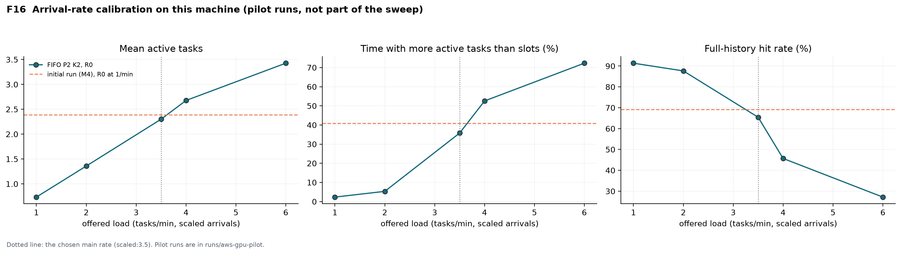

| FIFO P2 K2, R0 | 1/min | 2/min | 3.5/min | 4/min | 6/min | Target |
|---|---|---|---|---|---|---|
| Mean active tasks | 0.73 | 1.36 | **2.30** | 2.68 | 3.43 | 2.39 |
| Time above slot count | 2% | 5% | **36%** | 53% | 72% | 41% |
| Full-history hit rate | 91% | 88% | **65%** | 46% | 27% | 69% |

We chose 3.5 tasks/min. At this rate R2 reaches 3.93 active tasks and 85% of the time above the slot
count, and R1 stays light (1.25 active tasks), preserving the ordering of the three repeats. Two
quantities cannot be matched by any rate because they depend on hardware speed against fixed tool
delays: the server is busy 60% of a FIFO run on R0 (85% in the initial run), and a step takes 1.9 s
against 2.9 s of tool time per step (9.5 s against 2.9 s in the initial run).

### 5.4 Initial run

The project's initial measurements ran the same code, model, runtime commit, workloads and
configurations on an Apple M4 laptop (16 GB, Metal) at 1 task/min, with one run per configuration and
repeat (`runs/final`). Prefill there was about 184 tokens/s, so re-prefilling an 8K history took
44 s, and a limit of two active tasks raised throughput to 1.97× FIFO on R2 and 2.02× on the
development workload. Its FIFO contention on R0 is the calibration target above. Because the runs on
that machine were not repeated and the laptop was not isolated, this report uses it only as that
reference; all results below are from the T4.

### 5.5 Repeats, trials and metrics

A **repeat** is a different seeded task mix and arrival pattern; a **trial** re-runs the same repeat
on identical inputs. Every macro experiment was run as three trials; each trial restarted the server
and ran the server groups and P2 cases in a rotated order, so that no configuration always ran first.
Tables report, per configuration, the mean over repeats of the per-repeat trial means, and the SD
across repeats (workload variation); run-to-run noise is the spread across trials (Section 6.9).

Metrics: completed tasks per minute; P50 and P95 task completion time (arrival to last step,
including admission and queue waits); full-history hit rate (continuations whose reused tokens cover
the previous prompt and output); wasted prefill (prompt tokens evaluated beyond the step's new tokens);
server busy time (share of a run with at least one request in the server); KV demand (tokens the
admitted tasks need to keep their histories); and slowdown (completion time divided by isolated compute
time from J1 K1 runs plus the task's own tool delays), reported for short and long tasks (output
below or above the median).

**Failures** are kept in all denominators. **Timeouts:** the per-request deadline was 600 s; no request
exceeded 22 s. **Cold start:** model load and warm-up are measured per server launch and excluded from
the runs, which start from erased slots (Section 6.10).

The sweep comprised 120 evaluation runs and 18 development runs (1,104 tasks, 11,099 requests) and
took 10.4 hours.

## 6. Results

### 6.1 The cost of context and of losing it

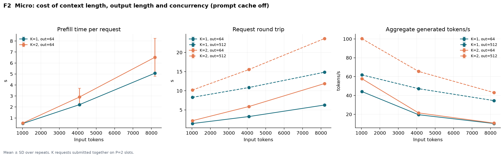

Prefill runs at about 1,565 tokens/s in the micro benchmark, so recomputing an 8K history takes 5.1 s,
as long as generating about 330 output tokens at the measured 66 tokens/s. The cache probe (F3)
shows what a lost history costs: a continuation of an 8K context whose slot was retained, left idle or
restored needs 0.03 s of prefill; after the slot was overwritten or erased it needs 5.1 s. Saving one
slot's 8K state (1,156 MiB) to disk took 8.95 s and restoring it 0.47 s; a full save, erase, restore
and continuation took 9.45 s against 5.13 s for re-prefill. After save, overwrite and restore, 64
greedy tokens and the serialized state hash were identical to the uninterrupted run.

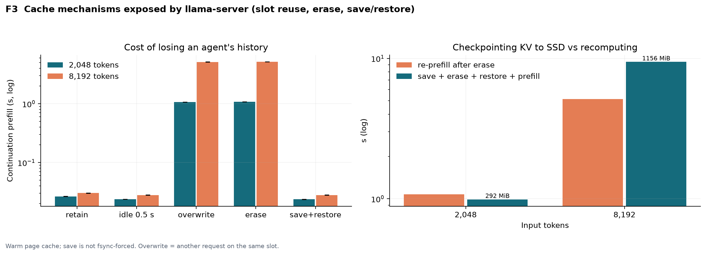

### 6.2 Baseline comparison

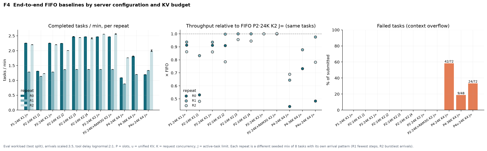

| Configuration | Completed | Tasks/min (mean ± SD over repeats) | P50 (s) | P95 (s) | Full-history hit | Wasted prefill |
|---|---|---|---|---|---|---|
| P2 K2 J∞ (FIFO) | 72/72 | 2.133 ± 0.662 | 65 | 132 | 57% | 62% |
| P2 K2 J4 | 72/72 | 2.086 ± 0.620 | 64 | 129 | 62% | 60% |
| P2 K2 J3 | 72/72 | 2.096 ± 0.627 | 59 | 128 | 69% | 60% |
| P2 K2 J2 | 72/72 | 1.875 ± 0.455 | 73 | 138 | 91% | 39% |
| P2 K1 J∞ | 72/72 | 1.914 ± 0.546 | 85 | 147 | 25% | 79% |
| P2 K1 J1 | 72/72 | 1.229 ± 0.086 | 155 | 241 | 100% | 0% |
| P1 K1 | 72/72 | 1.915 ± 0.547 | 84 | 147 | 25% | 79% |
| P2 K2 + host cache | 72/72 | 2.135 ± 0.663 | 66 | 132 | 57% | 64% |
| P4 K4, 24K | 30/72 | 1.246 ± 0.459 | 16 | 19 | 82% | 36% |
| P4u K4, 24K | 48/72 | 1.511 ± 0.430 | 36 | 92 | 79% | 43% |
| P4 K4, 36K (R0–R1) | 39/48 | 1.507 ± 0.429 | 29 | 102 | 90% | 47% |

Each row is 3 repeats × 3 trials × 8 tasks. The SD reflects the different task mixes of the repeats;
paired ratios on the same tasks are the more precise comparison:

| Throughput relative to FIFO | R0 | R1 | R2 |
|---|---|---|---|
| P2 K2 J4 | 1.00× | 1.00× | 0.94× |
| P2 K2 J3 | 1.00× | 1.00× | 0.96× |
| P2 K2 J2 | 0.91× | 1.00× | 0.79× |
| P2 K1 J∞ / P1 K1 | 0.91× | 0.94× | 0.86× |
| P2 K1 J1 | 0.53× | 0.83× | 0.48× |
| P2 K2 + host cache | 1.00× | 1.00× | 1.00× |
| P4 K4, 24K | 0.44× | 0.64× | 0.69× |
| P4u K4, 24K | 0.48× | 0.98× | 0.78× |

The table supports three observations. First, no admission limit improves throughput on the
evaluation workload, and a limit equal to the slot count (J2) loses 9% on R0 and 21% on R2. Second,
among the configurations that complete every task, a moderate limit (J3) has the lowest median and
tail latency (59 s and 128 s against 65 s and 132 s for FIFO) at 98% of FIFO throughput. Third, four
slots in the same budget fail: at 6K tokens per slot, 58% of P4 tasks overflow their slot; a unified
pool reduces this to 33%, and 9K tokens per slot (36K budget) to 19%. All 75 failed tasks are such
overflows. The host prompt cache has no measurable effect.

### 6.3 Concurrency and eviction

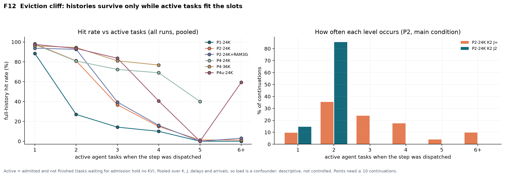

The full-history hit rate depends on how many tasks are active when a step is dispatched (pooled over
all runs of each server, so descriptive):

| Active tasks at dispatch | 1 | 2 | 3 | 4 | 5 |
|---|---|---|---|---|---|
| P2·24K | 98% | 81% | 37% | 15% | 1% |
| P4·24K | 97% | 81% | 72% | 69% | 40% |
| P4·36K | 96% | 94% | 81% | 77% | – |

With two slots, histories survive while at most two tasks are active and are lost almost always
beyond four; more slots move the cliff to more tasks, at the price of smaller per-slot contexts
(Section 6.2). Because the pool is preallocated, memory pressure does not appear in resident memory;
it appears as KV demand above the budget (F14). Under FIFO on R2, the admitted tasks would need up to
39,717 tokens to keep their histories, and demand exceeds the 24,576-token budget 54% of the time;
with J2 it never exceeds the budget (peak 17,853 tokens).

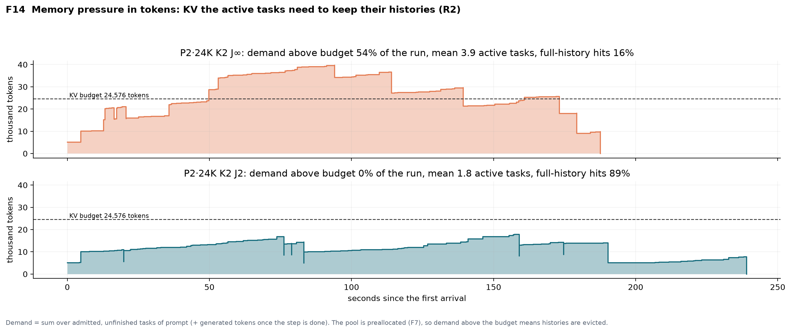

### 6.4 The admission limit

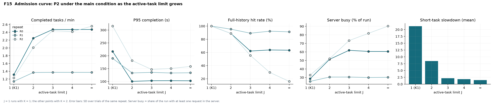

| Active-task limit J (P2) | 1 (K1) | 2 | 3 | 4 | ∞ |
|---|---|---|---|---|---|
| Tasks/min (mean of repeats) | 1.229 | 1.875 | 2.096 | 2.086 | 2.133 |
| P95 completion (s) | 241 | 138 | 128 | 129 | 132 |
| Full-history hit rate | 100% | 91% | 69% | 62% | 57% |
| Server busy (share of run) | 29% | 45% | 55% | 57% | 60% |
| Short-task slowdown | 21.22 | 8.49 | 2.15 | 1.80 | 1.50 |

The admission curve shows both failure modes. Lowering J preserves histories (57% → 91% hits) but
leaves the server idle (60% → 45% busy) and makes short tasks wait behind long ones. The time
breakdown (F5) shows where the time goes: a FIFO task spends on average 34 s in tool calls, 26 s in
model requests and 8 s in the queue; under J2 it spends 29 s waiting for admission and 18 s in model
requests, and completes 13 s later. Throughput reaches 98% of FIFO at J = 3, where the server is busy
55% of the time against 60% under FIFO.

### 6.5 Idle time and arrival rate

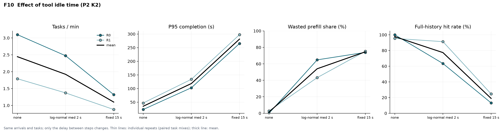

| FIFO P2 K2, R0–R1 | Tasks/min | P95 (s) | Full-history hit | Mean slowdown |
|---|---|---|---|---|
| No tool delay | 2.444 | 35 | 98% | 1.33 |
| Log-normal delay (main) | 1.922 | 118 | 77% | 1.19 |
| Fixed 15 s delay | 1.098 | 281 | 19% | 1.06 |
| Arrivals 1.75/min | 1.144 | 108 | 92% | 1.09 |
| Arrivals 3.5/min (main) | 1.922 | 118 | 77% | 1.19 |
| Arrivals 7/min | 2.461 | 130 | 48% | 1.39 |

Longer idle periods between steps increase eviction monotonically: with a fixed 15 s delay, only 19%
of continuations find their history, because other tasks overwrite the slot while the owner waits.
Higher arrival rates raise throughput while hits fall from 92% to 48% and P95 and slowdown grow.

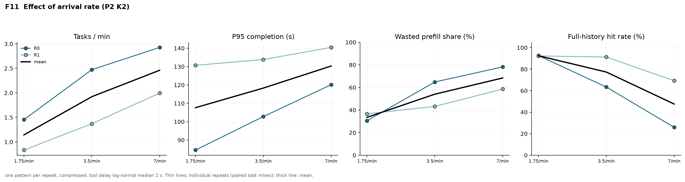

### 6.6 Context growth

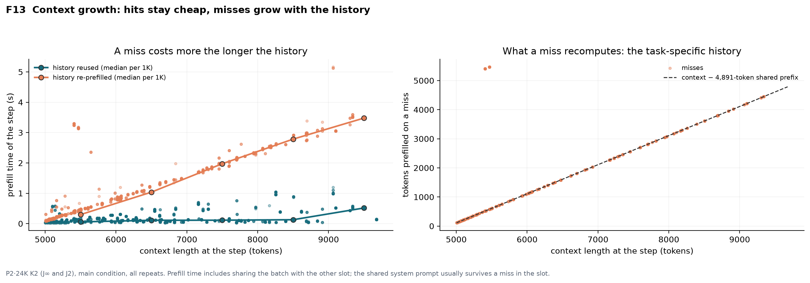

Among 2,724 continuations under P2 K2 (868 misses), a step that reuses its history needs a median of
0.1 s of prefill at any context length, while a miss needs 0.3 s at 5–6K tokens and 3.5 s at 9–10K.
On a miss the 4,891-token shared prefix usually survives in the slot, and the task-specific history
is recomputed (median 1,123 tokens) at about 0.7 s per 1,000 tokens under contention. The cost of
an eviction therefore grows linearly with the task's history. This analysis is observational: long
contexts are also the late steps of long tasks, which overlap more other tasks.

### 6.7 Memory

The KV pool is preallocated (3.38 GiB at 24K tokens, 5.06 GiB at 36K), so memory use is set by the
budget, not by load (F7). Server RSS on the host stays at 0.86 GiB; the weights and the KV pool reside
in GPU memory, where `nvidia-smi` reported 2,481–7,739 MiB in use depending on the configuration.
Memory limits act through the number and size of slots: hard overflows when per-slot contexts are
too small (P4), evictions when tasks outnumber slots (P2).

### 6.8 Fairness and slot placement

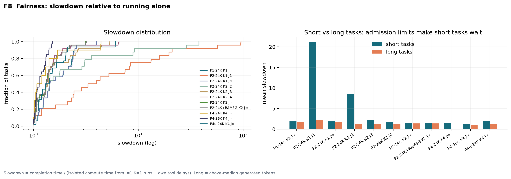

Short tasks suffer most from admission limits: their mean slowdown is 1.50 under FIFO, 2.15 under J3,
8.49 under J2 and 21.22 under K1 J1, while long-task slowdown in the same P2 configurations stays
between 1.27 and 2.26. Slot
placement is not agent-aware: with one request in flight (K1), llama.cpp sends 100% of requests to the
slot whose cached prompt shares the longest prefix, so P2 K1 behaves like P1 K1 (Section 6.2).

### 6.9 Development workload and run-to-run variation

| Dev workload, P2 | K2 J∞ | K2 J2 | K2 J3 | K2 J4 | K1 J∞ | K1 J2 |
|---|---|---|---|---|---|---|
| Tasks/min | 2.367 | 2.096 | 2.284 | **2.461** | 2.091 | 1.730 |
| Relative to K2 J∞ | 1.00× | 0.89× | 0.96× | **1.04×** | 0.88× | 0.73× |
| P95 (s) | 171 | 128 | 141 | 158 | 201 | 175 |

On the development tasks the best fixed baseline is P2 K2 J4. Run-to-run variation is small: across
the three trials of each experiment, the coefficient of variation of tasks/min is at most 0.8% for
the P2 configurations and 1.3% overall (P4u). Every difference reported above as a gain or a loss
(for example J2 at 0.91× and 0.79× FIFO, or J4 at 1.04× on the development tasks) is several times
larger, and falls on the same side of FIFO in every trial.

### 6.10 Cold start

Over 56 server launches, loading the model took 1.32 s at the median (at most 1.43 s), the server
listened after 1.37 s, and the first (warm-up) request took 245 ms. None of this enters the
measurements above, which describe a warm server; on a device that starts the server on demand, it
would add to the first task.

## 7. Dominant bottleneck

Under FIFO, history eviction is pervasive: 62% of prefill tokens recompute history that the task had
already computed, and only 57% of continuations find their history. Eviction is controlled by the
number of overlapping tasks relative to slots (Section 6.3), and its cost grows linearly with the
history length (Section 6.6).

On this GPU, however, eviction is not what limits completed work. Re-prefill accounts for 15% of
model time under FIFO; decode accounts for most of the rest, and a FIFO task spends half of its
completion time in tool calls. The server is busy only 60% of a FIFO run. Removing eviction with a
tight limit (J2) raises the hit rate to 91% but drops server busy time to 45%, because the admitted
tasks spend much of their time in tools; the re-prefill that FIFO spends per task (about 4 s) is
much smaller than the admission wait J2 adds (29 s per task). The binding constraint is therefore the
interaction between tool idle time and the number of admitted tasks: enough tasks must be admitted
to keep the server busy, but each task beyond the slot count turns idle time into eviction. The
measured optimum, J = 3–4 with two slots, sits where these effects balance. The initial run (Section
5.4) shows the same mechanism with the opposite outcome: there re-prefilling an 8K history took 8.5
times as long (44 s against 5.1 s) and steps were longer than tool calls, so preventing eviction
dominated.

## 8. Phase 2 direction

The measurements fix the Phase 2 design space and its baselines:

1. **Baselines to beat:** FIFO (P2 K2 J∞), the best fixed limit on the development workload (P2 K2
   J4, 1.04× FIFO), and llama.cpp's host prompt cache as the simple fixed cache policy.
2. **Admission should adapt rather than be fixed.** The best limit depends on the ratio of service
   time to tool time and on how many histories fit in the slots; both are observable at run time
   (per-step timings, tool durations, slot contents). A policy that admits tasks while the server
   would otherwise idle and while the admitted histories fit can keep FIFO's utilization and a high
   hit rate.
3. **Admission must not starve short tasks.** A fixed limit at the slot count raises short-task
   slowdown from 1.5 (FIFO) to 8.5 (J2); admission should use the remaining work of a task and age
   waiting tasks.
4. **Retention through checkpointing is useful only off the critical path.** Restoring an 8K slot
   takes 0.47 s against 5.1 s for re-prefill, but saving it takes 8.95 s; a checkpoint must be written
   while the task waits on a tool, and only for histories long enough to pay for the write.
5. **Slot affinity is a cheap first mechanism**, since llama.cpp's placement is not agent-aware.

Phase 2 will evaluate the policy on the evaluation workload against these baselines, with queue-only
and cache-only ablations, its own overhead, and the low-load and zero-delay conditions where little
benefit is expected.

## 9. Limitations

- **Replay fidelity.** The replay is append-only and derived from real trajectories; it preserves
  step counts, output lengths and context growth, but does not re-execute the customer-service
  semantics. Completion means that all recorded steps executed, not that the task succeeded.
- **Workload shape.** Every task starts with a 4.9K-token shared prefix and grows to at most 9.7K
  tokens, and outputs are short (median 49 tokens per step); short-context or long-output agents may
  behave differently.
- **Tool-delay model.** Log-normal delays (median 2 s) are an assumption; the captured τ²-bench gaps
  were shorter (at most 2.2 s), and Section 6.5 shows that the delay model strongly affects eviction.
- **Sample size.** Each run has 8 tasks, so runs include ramp-up and drain and there is no separate
  steady-state window; three task mixes (two for the sweeps) limit how far conclusions generalize
  across workloads, although run-to-run noise is small.
- **Arrival rate.** The main rate was calibrated on this machine to the contention of the initial
  run; absolute numbers are not comparable across machines.
- **Single platform.** All results come from one T4 instance at its 70 W power cap; its SM clock
  varied between 1,065 and 1,590 MHz (`runs/aws-gpu/logs/machine.log`).
- **User simulator.** The capture used DeepSeek rather than TritonAI for the simulated customer; it
  only shaped the recorded trajectories and is not called during any measurement.

## 10. Reproducibility

All artifacts are in this repository:

| Artifact | Location |
|---|---|
| Evaluation sweep (raw logs, server logs, GPU log, workloads, summaries, figures, generated report) | `runs/aws-gpu/` |
| Development sweep | `runs/aws-gpu-dev/` |
| Calibration pilot and the scripts that ran setup, pilot and sweep | `runs/aws-gpu-pilot/` |
| Live τ²-bench capture | `runs/final/raw/live_test`, `runs/final/raw/live_train` |
| Code | `phase1/`, `scripts/overnight.sh`, `tests/` |
| Procedure | `README.md` (Setup; AWS GPU), `docs/DESIGN.md` |

The sweep was run with

```bash
TRIALS=3 ARRIVAL_KIND=scaled ARRIVAL_RATE=3.5 EXTRA_J="3 4" WORKLOADS=runs/final \
  OUT=runs/aws-gpu DEV=runs/aws-gpu-dev HOURS=22 STOP_WHEN_DONE=1 bash scripts/overnight.sh
```

and every table and figure is regenerated from the raw logs, without the model or a GPU, by

```bash
.venv/bin/python -m phase1.final --results-dir runs/aws-gpu --main-arrival scaled:3.5
```

which also writes the detailed appendix `runs/aws-gpu/PHASE1_REPORT.md`. The instance, setup and
pilot cost about $6.50 of AWS credit.

## References

- τ²-bench, Sierra Research, v1.0.1: https://github.com/sierra-research/tau2-bench
- llama.cpp, commit `620d2225c` (build 11669): https://github.com/ggml-org/llama.cpp
- Qwen3-4B-GGUF, Qwen team, revision `bc640142`: https://huggingface.co/Qwen/Qwen3-4B-GGUF
